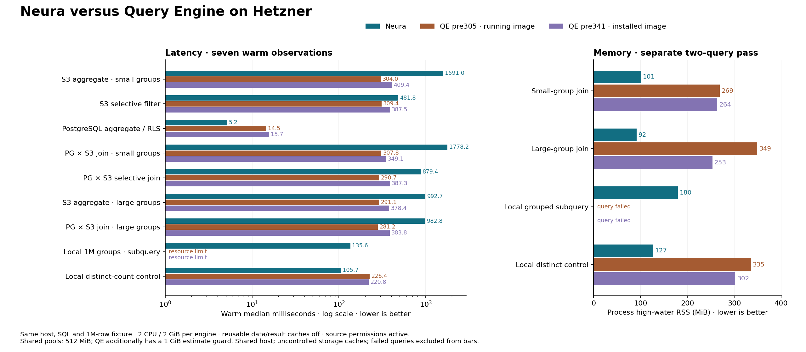

# Neura versus Query Engine on Hetzner

This experiment runs the current Neura engine and actual Datatailr Query Engine images on the same x86_64 machine. The primary QE image is the exact image of the host's running pre305 service; pre341 is an additional, newer image already installed on that host. Dedicated benchmark copies and dedicated sources are used. Existing services remain running.

Started `2026-09-28T15:52:23.414322+00:00`; finished `2026-09-28T15:57:28.875109+00:00`. Host: AMD EPYC-Genoa Processor, 16 logical CPUs. The host is shared; unrelated workload activity was not controlled.

**COMPLETED WITH QUERY FAILURES: 548/565 result checks matched the independent Python oracle.** 3 source governance probe sets completed. Harness errors: 0.

## Observations

The primary QE image completed the warm small-row-group join in 307.83 ms versus Neura's 1,778.19 ms. QE pre305 had lower warm medians on 6/6 S3 workloads; pre341 did so on 6/6.

Warm PostgreSQL aggregation: Neura 5.15 ms, QE pre305 14.52 ms, QE pre341 15.75 ms. Local distinct-count control: Neura 105.71 ms, QE pre305 226.39 ms, QE pre341 220.83 ms. The original grouped-subquery failures, concurrent-batch failures and memory observations are reported below. These are specific workload/resource observations, not universal superiority claims.

## Configuration

Each engine has **2 CPUs, 2 GiB container RAM and no additional swap**, with a nominal **512 MiB internal budget**. The tracked memory boundaries differ; the cgroup limit is the common hard boundary. PostgreSQL has 1 CPU / 512 MiB; S3 has 1 CPU / 1 GiB, with Go's soft memory limit configured at 512 MiB. These same source instances serve all engines. All engines use the same restricted PostgreSQL role, RLS policy and read-only S3 identity. No production credentials or tables are used.

Reusable data/result caching is disabled in this primary comparison, matching the existing pre305 service's cache settings. QE auto-optimized result reuse is off. Neura keeps its default bounded read-ahead and admission-aware parallelism. QE uses two worker threads and pool concurrency two. This does not represent every engine's fastest cached configuration.

QE additionally retains its documented **1 GiB per-query estimate guard**, separate from its 512 MiB shared pool. Neura has no directly equivalent separate guard. An initial smoke control with QE's guard reduced to 512 MiB rejected the million-group query at a reported 526 MiB; the 1 GiB guard also rejected it at a reported 1,029 MiB. These failures are retained. They are resource-limit errors, not incorrect returned results or OS OOMs. Equal container limits do not make internal memory accounting identical.

An initial timing attempt was invalidated when the S3 fixture was OOM-killed at a 512 MiB container limit. That run is retained as failure evidence and excluded from comparative performance claims. The final run uses the larger, bounded S3 fixture above; engine limits are unchanged.

The same immutable million-row Parquet files are used in two layouts: 1,024-row groups and 131,072-row groups. PostgreSQL contains 200 customers, of which RLS exposes 100. The local aggregation groups one million distinct order IDs. Object hashes, ETags, image IDs, source hashes and configuration hashes are in the raw record.

A ninth workload, `local_distinct_control`, computes the same checked scalar answers for this fixture using COUNT(DISTINCT) instead of the grouped subquery. It diagnoses sensitivity to query shape. Every engine receives the identical control SQL; it does not replace or hide the original grouped-query failures.

Native HTTP requests originate on the benchmark host, excluding SSH latency. Neura uses static bearer authentication and streams NDJSON; QE uses standalone JWT authentication and returns buffered JSON. QE login is part of readiness, outside query timing. Both clients fully consume results. Authentication implementations, catalog initialization and response formats differ; these are complete-service measurements, not isolated operator timings.

Neura uses its default REST-only build; optional PostgreSQL wire for Cube is not enabled in this profile. QE retains both its native REST and PG listeners. Existing QE services can share executable/library pages with the benchmark copies; consider RSS/high-water marks alongside PSS/cgroup accounting.

| Profile | Image | Image ID |
|---|---|---|
| Neura | `neura:hetzner-5bcc99c` | `sha256:0d1b38bc8b5c3b214b80e63aac56926a60db4e8a4ebd34880cdf77a2fb11c5fb` |
| QE pre305 | `datatailr/query-engine:0.1.0-pre305-amd64-pinned` | `sha256:e8c2c8870235e7dcc20cca37fa34bd9984bfc86f615bd65ba28e3677a46fa7b2` |
| QE pre341 | `datatailr/query-engine:0.1.0-pre341` | `sha256:16b1b4c3c0a8911f3fde485449e947dd7ae05573c1c0573d5485541ecf52e6fc` |

Neura source commit: `5bcc99c820e614532defb4bfec13117f1c97b14f`.

| Engine | Valid results / attempted checks | Failed checks |
|---|---:|---:|
| Neura | 213/213 | 0 |
| QE pre305 | 164/176 | 12 |
| QE pre341 | 171/176 | 5 |

Failed checks are retained and excluded from speed/memory wins:

- QE pre305 / `local_high_cardinality`: 5 failed checks (memory guard).
- QE pre341 / `local_high_cardinality`: 5 failed checks (memory guard).
- QE pre305 / `local_distinct_control`: 7 failed checks (query failures; inspect raw errors).

Kernel OOM evidence:

- QE pre305: `throughput` / `local_distinct_control`, container exit code 137.

## Warm latency

End-to-end median milliseconds with observed min–max in parentheses; lower is better. Each engine/workload starts fresh, executes one process-cold query and a full priming query before warm repetitions. Engine order rotates across workloads.

| Workload | Neura | QE pre305 | QE pre341 |
|---|---:|---:|---:|
| parquet_count | 1,591.03 (909.80–1,709.67) | 304.00 (101.42–400.28) | 409.38 (370.23–492.77) |
| parquet_filter | 481.77 (296.83–517.01) | 309.43 (281.52–402.47) | 387.52 (296.85–495.98) |
| postgres_rls | 5.15 (4.39–5.69) | 14.52 (5.10–20.46) | 15.75 (5.41–22.72) |
| federated_group | 1,778.19 (1,584.82–1,897.75) | 307.83 (267.90–401.31) | 349.15 (236.59–460.29) |
| federated_selective | 879.37 (698.50–1,084.70) | 290.66 (192.95–478.52) | 387.28 (291.11–475.22) |
| parquet_count_coarse | 992.68 (878.83–1,186.85) | 291.07 (280.25–383.21) | 378.45 (280.36–485.89) |
| federated_group_coarse | 982.84 (893.41–1,103.39) | 281.18 (204.76–367.21) | 383.78 (280.76–481.58) |
| local_high_cardinality | 135.56 (121.75–149.96) | Memory guard | Memory guard |
| local_distinct_control | 105.71 (93.79–126.31) | 226.39 (221.75–230.07) | 220.83 (199.46–256.52) |

## Process-cold latency

One observation per engine/workload after readiness; startup excluded. Source/OS/storage caches are not flushed. **These are not storage-cold measurements.**

| Workload | Neura | QE pre305 | QE pre341 |
|---|---:|---:|---:|
| parquet_count | 1,305.64 | 184.14 | 654.76 |
| parquet_filter | 393.64 | 207.38 | 546.79 |
| postgres_rls | 77.93 | 21.59 | 23.80 |
| federated_group | 1,827.24 | 354.81 | 780.42 |
| federated_selective | 950.70 | 218.19 | 627.48 |
| parquet_count_coarse | 668.04 | 234.84 | 529.09 |
| federated_group_coarse | 1,134.15 | 416.08 | 785.62 |
| local_high_cardinality | 152.54 | FAILED | FAILED |
| local_distinct_control | 155.96 | 240.01 | 246.29 |

## Throughput

Finite batch, concurrency two; higher is better. This is not an open-loop saturation test.

| Workload | Engine | Correct / attempted | Queries/sec |
|---|---|---:|---:|
| federated_group | Neura | 30/30 | 0.994 |
| federated_group | QE pre305 | 30/30 | 4.581 |
| federated_group | QE pre341 | 30/30 | 4.434 |
| federated_group_coarse | Neura | 30/30 | 1.695 |
| federated_group_coarse | QE pre305 | 30/30 | 5.832 |
| federated_group_coarse | QE pre341 | 30/30 | 4.535 |
| local_high_cardinality | Neura | 30/30 | 12.288 |
| local_high_cardinality | QE pre305 | Prime failed; batch not run | — |
| local_high_cardinality | QE pre341 | Prime failed; batch not run | — |
| local_distinct_control | Neura | 30/30 | 17.164 |
| local_distinct_control | QE pre305 | 23/30 | FAILED batch; see raw rates |
| local_distinct_control | QE pre341 | 30/30 | 5.353 |

## Separate memory pass

Two simultaneous queries after a fresh start. The observer samples at roughly 50 ms and is excluded from process totals. Short spikes may be missed; recorded process high-water marks are also shown. Summing multiple processes' high-water marks need not describe a simultaneous peak. PSS apportions shared pages. Cgroup peak includes startup, page cache and the observer, and may charge shared pages elsewhere. It is not interchangeable with process RSS.

| Workload | Engine | Sampled RSS MiB | High-water sum MiB | Sampled PSS MiB | Cgroup peak MiB |
|---|---|---:|---:|---:|---:|
| federated_group | Neura | 101.18 | 101.18 | 101.17 | 24.73 |
| federated_group | QE pre305 | 268.58 | 268.58 | 251.62 | 173.57 |
| federated_group | QE pre341 | 233.62 | 263.65 | 236.12 | 169.18 |
| federated_group_coarse | Neura | 91.51 | 91.51 | 91.50 | 13.99 |
| federated_group_coarse | QE pre305 | 348.83 | 348.83 | 348.61 | 253.36 |
| federated_group_coarse | QE pre341 | 229.61 | 253.17 | 229.84 | 169.31 |
| local_high_cardinality | Neura | 163.39 | 179.54 | 142.02 | 116.00 |
| local_high_cardinality | QE pre305 | FAILED query | — | — | — |
| local_high_cardinality | QE pre341 | FAILED query | — | — | — |
| local_distinct_control | Neura | 108.14 | 127.42 | 108.14 | 64.70 |
| local_distinct_control | QE pre305 | 331.05 | 335.14 | 309.92 | 253.14 |
| local_distinct_control | QE pre341 | 290.54 | 301.90 | 290.94 | 239.33 |

## Interpretation limits

- This is a small, static, synthetic, single-node PostgreSQL/S3-compatible benchmark. It does not establish production tail latency, cloud egress cost, distributed scaling or a universal ranking.
- The image of the running QE service is reproduced with equal limits; this is not a timing run against the untouched live service's original 4 CPU / 8 GiB deployment.
- Source permissions are checked through actual RLS results and PostgreSQL denial logs. Equal snapshot semantics under concurrent source mutations are not certified by this static test.
- QE may initialize catalogs before query timing; Neura resolves referenced sources per query. Warm metadata, connection pools, JIT and OS caches remain even when reusable data/result caches are off.
- Internal limits count different allocations. Use resident/cgroup observations alongside internal budgets; no global minimum-memory claim is justified.
- Earlier laptop Spark/DuckDB results use another architecture and host. They must not be numerically mixed with these Hetzner observations.

## Evidence

[Raw samples, plans and fingerprints](2026-09-28-hetzner-qe.json). [Reproduction instructions](../../benchmarks/HETZNER_QE.md).

[Initial invalid timing attempt](2026-09-28-hetzner-invalid-run.json) · [S3 fixture recovery and object hashes](2026-09-28-hetzner-source-recovery.json) · [512 MiB QE guard control](2026-09-28-qe-512-guard.json) · [Cleanup and existing-service verification](2026-09-28-hetzner-cleanup.json).
