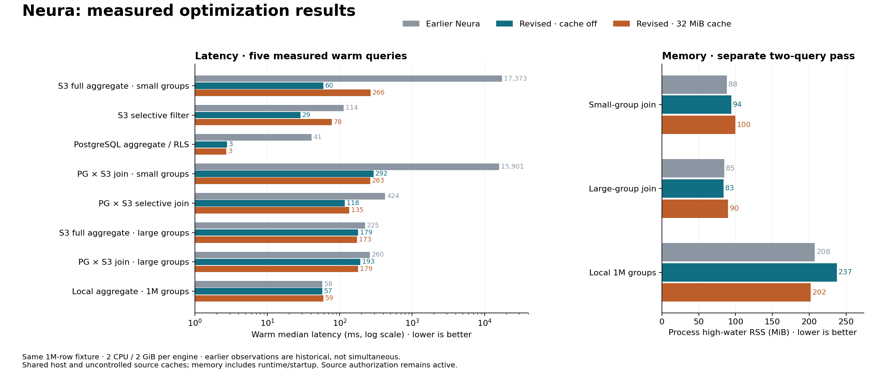

# Neura optimization measurements

These are real measurements using the same million-row fixture and 2 CPU / 2 GiB container limits as the earlier comparison. The earlier Neura, Spark and DuckDB observations are historical references, not simultaneous reruns. The revised profiles were measured separately on the shared host. No claim of statistical significance or universal superiority is made.

Both revised profiles use adaptive S3 read-ahead, admission-aware partition targets and PostgreSQL pooling. The second enables a 32 MiB reusable S3 file cache, deducted from the 512 MiB execution budget. Read-ahead also reserves from that execution pool. Cache hits require a current conditional GetObject request. This authorization cost is included.

## Interpretation

The default, cache-off small-row-group join changed from 15,900.60 ms to 291.99 ms warm. Its final warm source request count changed from 987 to 21, while origin response-body bytes changed from 3,000,582 to 8,139,416. Read-ahead trades additional bytes for fewer requests; this can matter for cloud egress and selective workloads.

**Faster does not imply lower peak memory.** The local aggregation's recorded process high-water RSS was 207.76 MiB before and 237.45 MiB with the revised default. The lower sampled RSS shown below misses brief peaks and must not be presented as an overall peak-memory improvement. The internal memory pool is not a limit on all process allocations.

**Caching remains opt-in.** The cached warm join transferred 16 origin body bytes for live authorization probes; HTTP/TCP headers are excluded. Cache-enabled latency was not consistently lower in this run. The profiles run sequentially, and local-only aggregation does not read the S3 cache: its throughput difference cannot be attributed to caching alone. Execution budget, scheduling, source conditions and shared-host noise also differ.

PostgreSQL pooling improves warm reuse; process-cold PostgreSQL setup still costs approximately 43 ms here. The earlier DuckDB default-cache join remains much faster on this small repeated-read fixture. These observations do not justify a fastest-engine or lowest-memory claim.

Raw measurements: [revised, cache off](2026-09-28-optimized.json) · [revised, cache 32 MiB](2026-09-28-optimized-cache.json) · [historical baseline](2026-09-28-spark-duckdb.json) · [historical DuckDB default cache](2026-09-28-duckdb-file-cache.json).

[Tuning controls and environment record](2026-09-28-optimization-controls.md).

## Correctness and provenance

- Revised, cache off: 125/125 result checks passed; 1 live governance probe sets passed. Started 2026-09-28T14:20:28.512643+00:00; finished 2026-09-28T14:20:49.315208+00:00.
  Image `sha256:5dccf623ccc44a6066b4b7552447db193ed112366ce537acb1a5be3a45c92939`; source commit `bf18760fdb0c185c74f3a6e4a0429284f739c72d`. Raw files additionally record exact source/configuration hashes.
- Revised, cache 32 MiB: 125/125 result checks passed; 1 live governance probe sets passed. Started 2026-09-28T14:20:49.504404+00:00; finished 2026-09-28T14:21:15.707677+00:00.
  Image `sha256:5dccf623ccc44a6066b4b7552447db193ed112366ce537acb1a5be3a45c92939`; source commit `bf18760fdb0c185c74f3a6e4a0429284f739c72d`. Raw files additionally record exact source/configuration hashes.

## Warm median latency (ms)

Five warm measurements after a full priming query; lower is better. DuckDB cache profiles are labelled separately. Missing entries were not measured.

| Workload | Earlier Neura | Revised, cache off | Revised, cache 32 MiB | Earlier Spark | Earlier DuckDB, cache off | Earlier DuckDB, default cache |
|---|---:|---:|---:|---:|---:|---:|
| parquet_count | 17,372.67 | 59.53 | 266.22 | 195.48 | 10,696.13 | 8.95 |
| parquet_filter | 113.63 | 28.74 | 77.92 | 218.74 | 126.79 | — |
| postgres_rls | 40.74 | 2.78 | 2.72 | 189.33 | 2.89 | — |
| federated_group | 15,900.60 | 291.99 | 263.02 | 546.33 | 20,838.55 | 19.10 |
| federated_selective | 423.95 | 118.15 | 134.59 | 395.00 | 740.20 | — |
| parquet_count_coarse | 224.76 | 179.10 | 173.46 | 318.83 | 122.56 | — |
| federated_group_coarse | 260.47 | 193.41 | 178.73 | 705.06 | 221.40 | 11.43 |
| local_high_cardinality | 57.70 | 57.14 | 59.41 | 403.39 | 59.69 | 60.64 |

## Process-cold latency (ms)

One sample after each engine restart and readiness; startup excluded. Source/OS/storage caches are retained and uncontrolled. This is **not storage-cold**.

| Workload | Revised, cache off | Revised, cache 32 MiB |
|---|---:|---:|
| parquet_count | 57.31 | 348.70 |
| parquet_filter | 35.80 | 121.72 |
| postgres_rls | 42.54 | 43.59 |
| federated_group | 176.32 | 348.24 |
| federated_selective | 187.13 | 221.61 |
| parquet_count_coarse | 197.30 | 199.98 |
| federated_group_coarse | 236.99 | 262.90 |
| local_high_cardinality | 57.37 | 54.77 |

## Throughput, queries/sec at concurrency two

| Workload | Earlier Neura | Revised, cache off | Revised, cache 32 MiB |
|---|---:|---:|---:|
| federated_group | 0.09 | 5.49 | 5.46 |
| federated_group_coarse | 6.20 | 8.23 | 8.07 |
| local_high_cardinality | 9.71 | 22.34 | 10.85 |

## Separate memory pass: sampled process peak RSS (MiB)

| Workload | Earlier Neura | Revised, cache off | Revised, cache 32 MiB |
|---|---:|---:|---:|
| federated_group | 88.20 | 93.37 | 98.64 |
| federated_group_coarse | 84.00 | 82.12 | 88.86 |
| local_high_cardinality | 179.57 | 120.55 | 186.27 |

## Separate memory pass: process high-water mark sum (MiB)

| Workload | Earlier Neura | Revised, cache off | Revised, cache 32 MiB |
|---|---:|---:|---:|
| federated_group | 88.20 | 94.25 | 99.79 |
| federated_group_coarse | 84.66 | 83.50 | 89.99 |
| local_high_cardinality | 207.76 | 237.45 | 202.27 |

## Concurrent local aggregation diagnostics

Spill counts below mean queries whose final physical-plan metrics include a nonzero spill count. Partition targets are chosen at admission; already-running plans retain their target.

| Profile | Queries that spilled | Admission targets observed |
|---|---:|---|
| Earlier Neura | 14/20 | not recorded |
| Revised, cache off | 0/20 | 1, 2 |
| Revised, cache 32 MiB | 0/20 | 1, 2 |

## Warm S3 diagnostics

Each row is the final successful warm query. Source request counters include instrumented scan operations, as in the original suite. `response_bytes` counts origin payload bytes; cache bytes are reported separately.

| Profile | Workload | Source requests | Origin bytes | Read-ahead hits | Cache hits | Cache bytes served |
|---|---|---:|---:|---:|---:|---:|
| Cache off | parquet_count | 21 | 8132474 | 964 | 0 | 0 |
| Cache off | parquet_filter | 8 | 1055520 | 0 | 0 | 0 |
| Cache off | federated_group | 21 | 8139416 | 964 | 0 | 0 |
| Cache off | federated_selective | 10 | 1324613 | 7 | 0 | 0 |
| Cache off | parquet_count_coarse | 15 | 1081996 | 0 | 0 | 0 |
| Cache off | federated_group_coarse | 15 | 1143324 | 0 | 0 | 0 |
| Cache 32 MiB | parquet_count | 21 | 16 | 964 | 16 | 8132474 |
| Cache 32 MiB | parquet_filter | 8 | 3 | 0 | 3 | 1055520 |
| Cache 32 MiB | federated_group | 21 | 16 | 964 | 16 | 8139416 |
| Cache 32 MiB | federated_selective | 10 | 5 | 7 | 5 | 1324613 |
| Cache 32 MiB | parquet_count_coarse | 15 | 10 | 0 | 10 | 1081996 |
| Cache 32 MiB | federated_group_coarse | 15 | 10 | 0 | 10 | 1143324 |

## Limits of this experiment

- Small static fixture, local S3-compatible storage, shared host; source CPU and memory limits remain unchanged. This is not an AWS/cloud-warehouse or distributed benchmark.
- Throughput is a finite batch of twenty queries, not a saturation or stable tail-latency estimate.
- Memory is a separate two-query pass with approximately 50 ms sampling, including service runtime; short spikes may be missed. Per-process high-water sums are not simultaneous peaks. Cgroup counters are retained separately in raw data.
- File caching is opt-in and may overread small objects on first use. It does not cache SQL results, metadata permissions, PostgreSQL rows or Iceberg/Glue data.
- The earlier DuckDB default-cache profile remains in the original report and must also be considered when comparing repeated reads. The no-cache reference table does not represent DuckDB's best warm performance.
- Missing warehouse credentials still block real Databricks, Snowflake, BigQuery and AWS S3/Glue validation. Lake Formation governed tables are unsupported and rejected.
